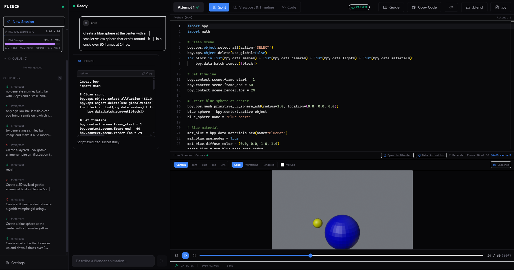

<h1 align="center">FLINCH</h1>

<p align="center">
  <strong>Native desktop "Cursor for Blender" with an automated execution and self-healing loop.</strong>
</p>

<p align="center">
  
</p>

<p align="center">
  <a href="#platform-support">Platform Support</a> •
  <a href="#features">Features</a> •
  <a href="#tech-stack">Tech Stack</a> •
  <a href="#requirements">Requirements</a> •
  <a href="#quick-start">Quick Start</a> •
  <a href="#cli--evals">CLI & Evals</a> •
  <a href="#under-development">Under Development</a>
</p>

---

## Overview

**Flinch** is an open-source native desktop interface that turns natural language prompts into working Blender 3D and 2D (Grease Pencil) scenes.

Rather than outputting untested Python code, Flinch **executes generated `bpy` scripts inside a headless Blender harness, captures runtime errors and tracebacks, and automatically feeds diagnostics back to the LLM** until the script compiles, passes scene assertions, and renders (or exhausts its attempt budget).

---

## Platform Support

> [!IMPORTANT]
> **Currently Supported: Windows 10 & 11 (64-bit)**
> 
> Active development and hardware testing currently target **Windows**. Native process-tree termination is handled via Windows Job Objects, and Blender binary discovery is optimized for standard Windows installation paths.
> 
> **macOS & Linux** support is planned for upcoming milestones (see [Under Development](#under-development)).

---

## Features

- **Headless Execution & Self-Healing Loop:** Generated `bpy` scripts run headlessly (`blender -b`). Failures, traceback line numbers, scene statistics, and console logs are fed back into the model to self-heal across up to 3 attempts.
- **AST Compatibility Engine:** Automatically handles breaking API changes between Blender versions (such as Blender 4.0+/5.2 Principled BSDF socket changes) while preserving custom node group sockets and valid inputs.
- **Live Viewport Canvas:** Interactive preview powered by Blender Workbench rendering, featuring frame scrubbing, sequence baking, and direct "Open in Blender" functionality.
- **Smart Code Editor:** Pitch-black Cursor-style Monaco editor with syntax highlighting, visual diff comparison between attempts, and a per-attempt diagnostics terminal.
- **Zero Vendor Lock-In:** Pure OpenAI-compatible streaming client (`/v1/chat/completions`) with exponential backoff and jitter. Works with local Ollama or free tiers of NVIDIA NIM, Groq, OpenRouter, and Google AI Studio without proprietary SDKs.
- **Local Persistence & Export:** Stores session history, prompts, code revisions, and diagnostics in local SQLite (`history.db`). Export scenes directly as `.blend` or `.py` files.
- **Reproducible 30-Prompt Eval Suite:** Measures `pass@1` (zero-shot) vs `pass@3` (with error feedback) across easy, medium, and hard Blender tasks.

---

## Tech Stack

| Layer | Technology | Details |
|---|---|---|
| **Core Backend** | **Rust** | Tokio async runtime, Reqwest streaming HTTP, Rusqlite (bundled SQLite), Thiserror |
| **Desktop Shell** | **Tauri 2** | Thin desktop wrapper; exposes `flinch-core` commands and event streaming (`agent://token`, `blender://log`) |
| **Frontend** | **React 19 + TypeScript** | Strict mode (zero `any`), Vite, Tailwind CSS, Zustand state management |
| **Code Editor** | **Monaco Editor** | Custom pitch-black Cursor palette, side-by-side diff mode, custom gutter |
| **Package Manager** | **Bun** | Bun 1.x runtime & workspace manager (never npm, yarn, or pnpm) |
| **Blender Harness** | **Python 3 (`bpy`)** | Single execution entrypoint (`blender/harness.py`), AST compatibility rewriter, scene assertions (`blender/checks.py`) |
| **LLM Engine** | **OpenAI-Compatible** | SSE streaming, request cancellation, configurable token limits, exponential backoff on 429/5xx |
| **Architecture** | **Workspace Monorepo** | Rust Cargo workspace (`crates/flinch-core`, `crates/flinch-cli`) + Tauri desktop app (`apps/desktop`) |

---

## Requirements

Ensure the following dependencies are installed on your machine before running Flinch:

1. **Operating System:** Windows 10 or 11 (64-bit).
2. **Blender:** [Blender LTS](https://www.blender.org/download/lts/) (pinned to **5.2 LTS** in `blender/VERSION`; 4.2+ LTS supported). Must be installed on your system.
3. **Rust:** Stable toolchain (1.85+ recommended; pinned in `rust-toolchain.toml`). Install via [rustup.rs](https://rustup.rs/).
4. **Bun:** Bun 1.x runtime. Install via `powershell -c "irm bun.sh/install.ps1 | iex"`.
5. **C++ Build Tools:** Microsoft C++ Build Tools or Visual Studio with Desktop development with C++ (required by Tauri).
6. **LLM Provider:** An OpenAI-compatible API endpoint:
   - **Local:** [Ollama](https://ollama.com) running locally (`http://localhost:11434/v1`).
   - **Cloud (Free Tiers):** NVIDIA NIM, Groq, OpenRouter, or Google AI Studio.

> [!NOTE]
> A standalone Python installation is **not** required. Flinch invokes the Python interpreter bundled directly within your Blender installation.

---

## Quick Start

Follow these steps from the repository root:

### 1. Install Frontend Dependencies
```bash
bun install
```

### 2. Configure Local Settings
Copy the template configuration file:
```bash
cp flinch.example.toml flinch.toml
```
Open `flinch.toml` and configure your Blender executable path and LLM provider credentials:
```toml
[blender]
# Path to your Blender executable
bin = "C:\\Program Files\\Blender Foundation\\Blender 5.2\\blender.exe"

[provider]
kind = "openai_compatible"
base_url = "https://integrate.api.nvidia.com/v1"
model = "meta/llama-3.3-70b-instruct"
api_key = "nvapi-your-key-here"  # Or leave empty and set api_key_env
api_key_env = "NVIDIA_API_KEY"
max_concurrency = 1
max_tokens = 4096
```

### 3. Run System Diagnostics
Verify your Blender installation, version, and provider reachability:
```bash
cargo run -p flinch-cli -- doctor
```

### 4. Launch the Desktop Application
Start the Tauri desktop app in development mode:
```bash
bun run dev
```
Tauri will compile the Rust backend, launch the Vite development server, and open the desktop window with streamed chat, live viewport canvas, and Monaco editor.

---

## CLI & Evals

Flinch provides a headless CLI binary (`flinch-cli`) for automation, scripting, and reproducible benchmarks:

```bash
# Verify system readiness
cargo run -p flinch-cli -- doctor

# Execute a single prompt through the full LLM agent self-healing loop
cargo run -p flinch-cli -- run "a red glossy sphere bouncing on a reflective plane"

# Test an existing Python script through the headless harness
cargo run -p flinch-cli -- harness path/to/script.py

# Run the reproducible evaluation suite (easy, medium, or hard tiers)
bun run eval -- --tier easy

# Run a specific evaluation prompt by ID
bun run eval -- --id med-04

# Run evaluation with a specific provider and model
bun run eval -- --provider http://localhost:11434/v1 --model qwen2.5-coder:7b
```

Evaluation methodology and latest benchmarks are documented in [docs/EVALS.md](docs/EVALS.md).

---

## Under Development

Flinch is under active development. Current focus areas and upcoming roadmap items:

- [x] **Windows 10/11 Support:** Full process-tree isolation via Job Objects and automatic Blender path discovery.
- [x] **Headless Execution & Self-Healing Loop:** AST compatibility rewriting and scene assertions.
- [x] **Desktop Interface:** Tauri 2 desktop shell, pitch-black Monaco editor, and live viewport scrubbing.
- [x] **Session Persistence:** SQLite-backed multi-turn prompt history and script restoration.
- [ ] **Cross-Platform Support:**
  - **macOS:** Darwin process groups (`killpg`) and Metal-friendly headless Workbench preview.
  - **Linux:** Process group isolation and X11/Wayland headless frame rendering.
- [ ] **Grease Pencil v3 Expansion:** Expanded stroke drawing templates and layer hierarchy generators for Blender 4.3+/5.2.
- [ ] **Direct Multi-Engine Rendering:** Interactive selection between Workbench, EEVEE, and Cycles with customizable sample counts.
- [ ] **30-Prompt Benchmark Reports:** Comprehensive pass@1 vs pass@3 performance tables across open-source and commercial models.

---

## Code Quality & Verification

Before submitting changes or opening a pull request, run the complete verification check:

```bash
# Full test and lint suite (bindings + fmt + clippy + cargo test + typecheck)
bun run check

# Verify production desktop build
bun run build

# Python harness unit tests
pytest blender/tests/test_harness.py
```

All backend rules, architecture guidelines, and coding standards are detailed in [AGENTS.md](AGENTS.md).

---

## License

This project is licensed under the [MIT License](LICENSE).
